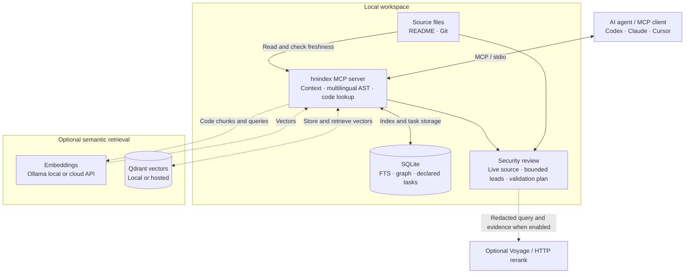

<div align="center">

# vibe-hnindex

**Local MCP server — index your repo once, search it in every AI session**

*Keyword (SQLite FTS5) · Semantic (Qdrant + configurable embeddings) · Hybrid — local or cloud embedding providers*

[](https://www.npmjs.com/package/vibe-hnindex)
[](https://www.npmjs.com/package/hnindex-cli)
[](LICENSE)
[](https://modelcontextprotocol.io/)
[](https://nodejs.org/)

<!-- hnindex:release:start -->
Current release: **v0.16.1** · MCP server `vibe-hnindex` · installer `hnindex-cli`. [Release notes](https://github.com/AndyAnh174/vibe-hnindex/releases/tag/v0.16.1)
<!-- hnindex:release:end -->

[Docs](https://docs.hnindex.cloud) · [Changelog](https://hnindex.cloud/changelog) · [npm server](https://www.npmjs.com/package/vibe-hnindex) · [npm CLI](https://www.npmjs.com/package/hnindex-cli)

</div>

---

## What this does

[vibe-hnindex](https://www.npmjs.com/package/vibe-hnindex) is a [Model Context Protocol](https://modelcontextprotocol.io/) server. After you **index** a folder once, assistants (Claude, Cursor, Windsurf, Antigravity, …) can **search** that codebase with paths and line ranges — data is stored locally (SQLite + optional Qdrant). Embeddings use **Ollama** (default), **OpenAI**, **Voyage**, **Gemini**, or an **OpenAI-compatible API**; see [Embedding providers](docs/embedding-providers.md). Cloud providers receive the content being embedded; vectors use **Qdrant** (Docker, local, or [Qdrant Cloud](https://cloud.qdrant.io/) with `QDRANT_API_KEY`).

---

## Documentation

[Source security review](docs/security-tools.md): `security_audit`, `security_context` and `pentest_plan` provide live source evidence and validation checks. Optional Voyage/HTTP rerank follows server configuration; `rerank:false` keeps review local. Results are heuristic review leads with explicit coverage, not confirmed vulnerability reports.

📚 **Full docs site: [docs.hnindex.cloud](https://docs.hnindex.cloud)** — 16 pages covering Getting Started, Configuration, Tools Reference, Guides, and Code Agent.

| Page | What you'll learn |
|------|-------------------|
| [Introduction](https://docs.hnindex.cloud) | What vibe-hnindex does, key features, how it works |
| [Installation](https://docs.hnindex.cloud/getting-started/installation) | Node, Ollama, Qdrant setup + MCP config |
| [Quick Start](https://docs.hnindex.cloud/getting-started/quick-start) | 5-minute walkthrough with CLI + agent skill |
| [Configuration](https://docs.hnindex.cloud/configuration) | All 25+ env vars with embedding model comparison |
| [Search](https://docs.hnindex.cloud/tools/search) | 6 search modes, regex, fuzzy, streaming, cache |
| [Code Agent](https://docs.hnindex.cloud/tools/code-agent) 🆕 | code_session + code_apply with safety scopes |
| [Setup MCP](https://docs.hnindex.cloud/guides/setup-mcp) | Per-platform config (Claude, Cursor, Antigravity, VS Code...) |

Also available in-repo: [docs/getting-started.md](docs/getting-started.md), [docs/configuration.md](docs/configuration.md), [docs/tools-reference.md](docs/tools-reference.md).

---

## CLI installer (`hnindex`)

Optional — writes MCP JSON or Codex TOML for you (merge-safe, same `npx -y vibe-hnindex` block as in the docs):

```bash
npm install -g hnindex-cli

# Setup MCP config
hnindex init --mcp antigravity    # or: claude, cursor, windsurf, vscode, codex
hnindex init --list               # show all targets and paths

# Install AI agent skill (recommended)
hnindex init-skill --target claude    # or: antigravity, cursor, windsurf, vscode
hnindex init-skill --list             # show all skill targets

# Update
hnindex update                    # npm update -g hnindex-cli
```

See **[docs.hnindex.cloud](https://docs.hnindex.cloud)** for full documentation.

---

## Install in 5 steps

1. **Node.js** — v22+ ([nodejs.org](https://nodejs.org/)). CI verifies Node 22 and 24. SQLite uses N-API binaries bundled for supported platforms; see [Troubleshooting → Windows](docs/troubleshooting.md#windows-npm-install) if `npm i vibe-hnindex` fails.
2. **Embedding provider** — choose [OpenAI, Voyage, Gemini or a compatible API](docs/embedding-providers.md), or use local **Ollama**: install from [ollama.com](https://ollama.com/), then: `ollama pull bge-m3:567m` and keep `ollama serve` running (or set `OLLAMA_URL` to a remote server).
3. **Qdrant** — for semantic/hybrid search: `docker run -d --name qdrant -p 6333:6333 qdrant/qdrant` (or use Qdrant Cloud). Keyword-only search works without Qdrant.
4. **MCP config** — add the server to your assistant’s MCP settings. Minimal example (self-hosted Qdrant):

```json
{
  "mcpServers": {
    "vibe-hnindex": {
      "command": "npx",
      "args": ["-y", "vibe-hnindex"],
      "env": {
        "OLLAMA_URL": "http://localhost:11434",
        "OLLAMA_MODEL": "bge-m3:567m",
        "QDRANT_URL": "http://localhost:6333",
        "SEARCH_STREAM_ENABLED": "true",
        "CODE_AGENT_ENABLED": "true",
        "CODE_AGENT_SCOPE": "moderate",
        "CHAT_MEMORY_ENABLED": "true"
      }
    }
  }
}
```

5. **Restart** the IDE or assistant, then in chat ask to **index** a path and **search** — see [First steps](docs/getting-started.md#first-steps-in-chat).

For **Qdrant Cloud**, add `QDRANT_API_KEY` and set `QDRANT_URL` to your HTTPS cluster URL — details in [Getting started](docs/getting-started.md).

### Agent Workspace

`workspace_context` identifies the active project purpose, Git/index state and a declared task persisted per project/session. `locate_code` finds files/symbols then keywords locally, returning line evidence and freshness. Explicit hybrid mode uses configured semantic APIs. MCP startup instructions and `knowledge://workspace` expose this workflow. Project-scoped CLI installs bind their root automatically; global installs follow client roots unless explicitly configured.

See [Workspace and code locations](docs/workspace.md). Refresh stale positions before editing; use filesystem tools for unavailable or excluded code.

### Code Graph

Build a multilingual AST symbol graph with `index_code_graph(path, project_name)` using SQLite alone. `index_codebase` also builds it; file indexing and watching update relationships automatically. Use `find_references`, `callers`, and `graph_context` to inspect source evidence and bounded relationship context. SQLite remains the graph backend. JS/TS retain compiler resolution; Python, PHP, Go, Java, C/C++, C#, Rust, Ruby, Kotlin, Swift, Scala and Lua use bundled offline Tree-sitter profiles. See the language coverage and resolution limits in the graph guide.

AST chunking preserves function/class boundaries where possible. After upgrading, run `index_codebase` once to rebuild chunks and vectors. See [Code Graph guide](docs/code-graph.md) for resolution limits, offline usage, token budgets and quality evaluation.

### Optional rerank

Hybrid search combines keyword results and embedding vectors using RRF. Optional reranking supports **Voyage** (`RERANK_PROVIDER=voyage`, `VOYAGE_API_KEY` or `RERANK_API_KEY`) and **custom HTTP** (`RERANK_PROVIDER=http`, `RERANK_URL`). Without a reranker, or if it fails, the original retrieval ranking is preserved. Exact symbol/regex modes skip reranking.

| Env | Role |
|-----|------|
| `SEARCH_RERANK` | `false` disables reranking. |
| `SEARCH_RERANK_POOL` | Candidate pool before final trim (default `50`; at least the requested limit). |
| `RERANK_PROVIDER` | `none`, `http`, `voyage`; defaults to `http` when `RERANK_URL` is set, otherwise `none`. |
| `RERANK_MODEL` | Voyage model, default `rerank-3-lite`. |
| `RERANK_URL` | Custom endpoint; HTTP contract is `{query, documents}` -> `{scores}`. |
| `RERANK_API_KEY` | Optional Bearer credential; Voyage can use `VOYAGE_API_KEY`. |
| `RERANK_TIMEOUT_MS` | Full request/body timeout, default `15000`. |

See [Configuration](docs/configuration.md#optional-rerank).

### Timeouts

To prevent hanging when Ollama or Qdrant are unresponsive, vibe-hnindex applies timeouts on all external calls. You can tune these via environment variables:

| Env | Default | Controls |
|-----|---------|----------|
| `OLLAMA_TIMEOUT_MS` | `30000` (30s) | Max wait for Ollama `/api/embed` and `/api/tags` calls |
| `QDRANT_TIMEOUT_MS` | `15000` (15s) | Max wait for Qdrant API calls (search, upsert, etc.) |
| `SEARCH_TIMEOUT_MS` | `60000` (60s) | Overall timeout for the entire search operation |

Set any of these to a higher value if you have a slow machine or large dataset. Set to `0` to disable the timeout for that layer (not recommended).

### Google Antigravity

Use the **same** `mcpServers` block as above, but save it in Antigravity’s MCP file:

| | |
|--|--|
| **File** | `mcp_config.json` under **`.gemini/antigravity/`** in your user folder |
| **Windows** | `C:\Users\<your-username>\.gemini\antigravity\mcp_config.json` |
| **macOS / Linux** | `~/.gemini/antigravity/mcp_config.json` |
| **UI** | **⋮** menu → **MCP** → **Manage MCP Servers** → **View raw config** |

Step-by-step: [Integrations → Google Antigravity](docs/integrations.md#google-antigravity).

---

## Features (short)

| | |
|--|--|
| **Search** | 6 modes: keyword (FTS5+BM25), semantic (Qdrant vectors), hybrid (RRF fusion), regex, symbol, auto |
| **Code Agent** | `code_session` — 1 call replaces 5-15 searches. `code_apply` — safe code changes with auto test/lint/typecheck |
| **Chat Memory** 🆕 | Auto-track tool calls, semantic search via Qdrant, persistent AI context across sessions |
| **Streaming** | Parallel keyword+semantic search with progress notifications |
| **Fuzzy Search** | Levenshtein distance auto-corrects typos ("fucntion" → "function") |
| **Smart Context** | Task-aware context: impact analysis, test file detection, similar code patterns |
| **Storage** | SQLite for keyword, graph and metadata; Qdrant for vectors; optional cloud embedding/rerank providers |
| **Indexing** | Incremental change detection, parallel workers, watch mode, text indexing across languages, `.hnindexignore` |
| **Resilience** | Keyword search works without Qdrant or Ollama; graceful degradation |
| **Benchmark** | Built-in `benchmark_search` tool — compare streaming vs non-streaming, all search modes |
| **Multiple Embedding Providers** | Ollama, OpenAI, Voyage, Gemini and OpenAI-compatible APIs; provider/model-aware vector collections |
| **Multiple Embedding Models** | bge-m3 (default), nomic-embed-text, qwen3-embedding, mxbai-embed-large, and more |

---

## Architecture

<!-- hnindex:architecture:start -->

<!-- hnindex:architecture:end -->

<p align="center">
  <a href="docs/how-it-works.md">How indexing &amp; search work →</a>
</p>

---

## License

MIT — see [LICENSE](LICENSE).

## Contributing

Issues and PRs: [github.com/AndyAnh174/vibe-hnindex](https://github.com/AndyAnh174/vibe-hnindex).

## Contact

**Ho Viet Anh (AndyAnh174)** · [hovietanh147@gmail.com](mailto:hovietanh147@gmail.com) · [GitHub](https://github.com/AndyAnh174)

## Codex and architecture

Run `npx -y hnindex-cli init --mcp codex` inside the project, then optionally `npx -y hnindex-cli init-skill --target codex`. Codex project MCP uses `.codex/config.toml` (trusted projects only); skills use `.agents/skills/use-vibe-hnindex`. Restart/reconnect Codex and ask for `workspace_context`, followed by `index_code_graph`.

See [CLI configuration](packages/hnindex-cli/README.md#codex-setup), [system, sequence and user diagrams](docs/architecture.md), and [official Codex MCP setup](https://learn.chatgpt.com/docs/extend/mcp?surface=cli).
